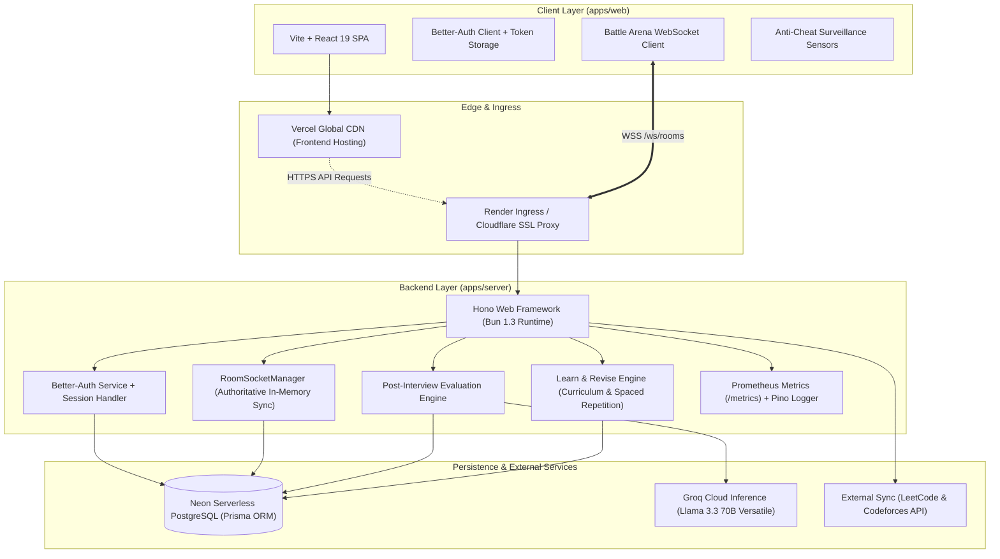
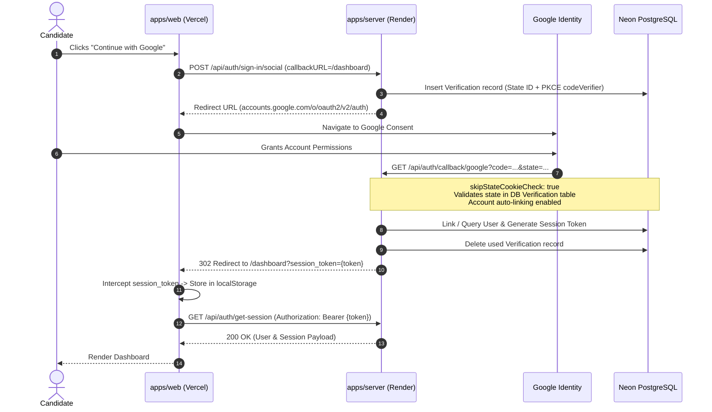
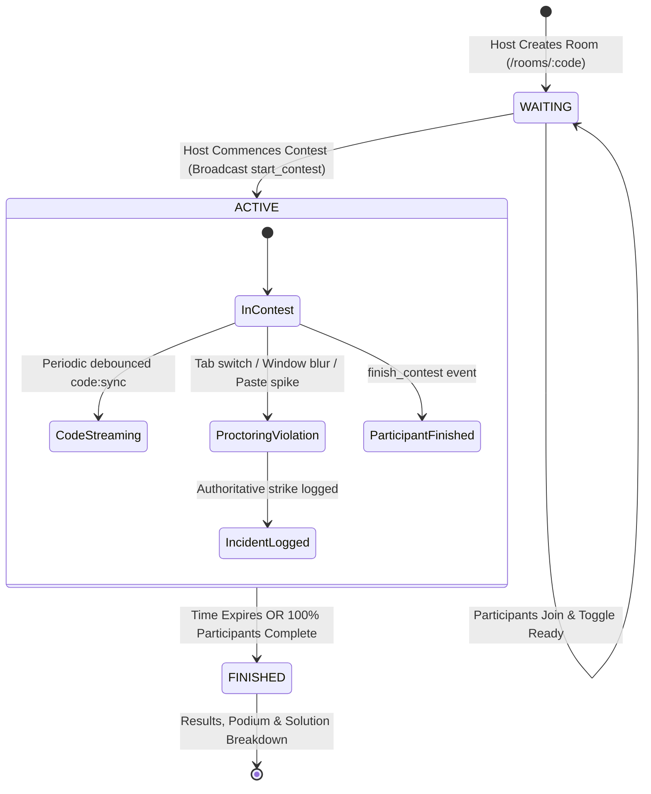
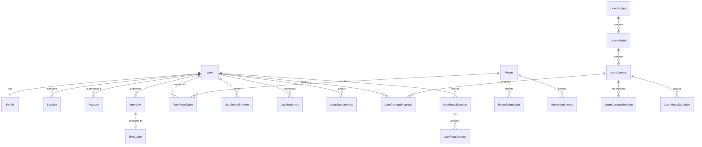

# 🏛️ interVue — System Architecture & Design Specification

> **Version:** 2.0.0  
> **Target Environment:** Multi-tier distributed cloud (Vercel Edge CDN + Render Bun Container + Neon Serverless PostgreSQL)  
> **Monorepo Structure:** Turborepo with Bun workspaces (`apps/web`, `apps/server`, `packages/db`)

---

## 📑 Table of Contents

1. [High-Level Architecture](#1-high-level-architecture)
2. [Monorepo Layout & Module Boundaries](#2-monorepo-layout--module-boundaries)
3. [Authentication & Session Lifecycle](#3-authentication--session-lifecycle)
4. [Core Subsystems](#4-core-subsystems)
   - [4.1 AI Technical Mock Interview & Evaluation Engine](#41-ai-technical-mock-interview--evaluation-engine)
   - [4.2 Real-Time Multiplayer Battle Arena](#42-real-time-multiplayer-battle-arena)
   - [4.3 Authoritative Anti-Cheat Surveillance System](#43-authoritative-anti-cheat-surveillance-system)
   - [4.4 Target Company Preparation Kits & Flagship Sheets](#44-target-company-preparation-kits--flagship-sheets)
   - [4.5 Gamification & Consistency Tracking Engine](#45-gamification--consistency-tracking-engine)
   - [4.6 Learn & Revise Hub, Interactive Visualizers & Spaced Repetition](#46-learn--revise-hub-interactive-visualizers--spaced-repetition)
5. [Data Architecture & Database Modeling](#5-data-architecture--database-modeling)
6. [Observability, Resilience & Security](#6-observability-resilience--security)
7. [Deployment Topology & Infrastructure](#7-deployment-topology--infrastructure)

---

## 1. High-Level Architecture

The interVue platform is architected around a decoupled, event-driven, full-stack monorepo design:



---

## 2. Monorepo Layout & Module Boundaries

interVue uses **Turborepo** with **Bun Workspaces** to guarantee strict encapsulation and atomic cross-package sharing:

```
intervue/
├── apps/
│   ├── server/                         # Backend API (Hono on Bun runtime)
│   │   ├── src/
│   │   │   ├── lib/                    # Auth, Prisma client, errors, metrics, guardrails
│   │   │   ├── middleware/             # requireAuth, requireAdmin, problem-details
│   │   │   ├── routes/                 # admin, chat, interview, profile, rooms, sheets, search
│   │   │   ├── services/               # evaluation, companyService, roomSocket
│   │   │   ├── types/                  # AuthVariables, WebSocket messages
│   │   │   └── index.ts                # Server bootstrap, CORS, WebSocket routing
│   │   ├── Dockerfile                  # Production container definition (oven/bun:1.2-slim)
│   │   └── package.json
│   │
│   └── web/                            # Frontend SPA (React 19, Vite, Tailwind CSS)
│       ├── src/
│       │   ├── components/             # Layout, Shared HUD, Company Kits, UI components
│       │   ├── hooks/                  # useAntiCheat, useDailyTargets, useProfile, useRoomSocket
│       │   ├── lib/                    # api (Axios), auth (Better-Auth client), utils
│       │   ├── pages/                  # Landing, Login, Dashboard, Interview, Rooms, Sheets
│       │   ├── App.tsx                 # Route declarations & ProtectedRoute barriers
│       │   └── main.tsx                # Client bootstrap & React Query provider
│       └── package.json
│
├── packages/
│   └── db/                             # Shared Persistence Layer
│       ├── prisma/
│       │   ├── schema.prisma           # Authoritative Prisma schema
│       │   └── seed.ts                 # Problem seed catalog & assessments
│       └── index.ts                    # Re-exported PrismaClient singleton
│
├── turbo.json                          # Turbo build pipeline definitions
└── package.json                        # Monorepo dependencies & root scripts
```

---

## 3. Authentication & Session Lifecycle

The authentication architecture is powered by **Better-Auth** with dual-mode support: **Google OAuth 2.0** and **Email/Password credentials**.



### Key Security & Reliability Controls
* **Cross-Domain Cookie Resilience (`skipStateCookieCheck: true`)**: Because the frontend (`.vercel.app`) and backend (`.onrender.com`) exist on disparate origins, modern browsers (Chrome ITP, Safari, Firefox tracking protection) block third-party cookies across redirects. interVue authenticates state via the authoritative database `Verification` record with PKCE `codeVerifier`, preventing false `state_mismatch` errors.
* **Dual-Token Storage (Bearer Fallback)**: Session tokens are attached to Axios and Better-Auth request interceptors via `Authorization: Bearer <token>`, ensuring uninterrupted access across all browsers and private/incognito tabs.
* **Automatic Account Linking**: When an existing email/password candidate signs in with Google, accounts automatically link safely, preventing duplicate accounts or `account_not_linked` lockouts.

---

## 4. Core Subsystems

### 4.1 AI Technical Mock Interview & Evaluation Engine

The mock interview engine simulates an interactive, rigorous FAANG technical evaluation.

* **Adaptive Conversational Interviewer**:
  * Utilizes **Groq Llama 3.3 70B Versatile** with system guardrails enforcing senior staff interviewer personas.
  * Adjusts question depth dynamically according to candidate seniority (Junior $\to$ Mid $\to$ Senior) and track (DSA, System Design, Frontend, Backend).
  * Implements a progressive hint ladder: nudges candidates toward optimal time/space complexity without revealing explicit solutions.
* **Multi-Dimensional Post-Interview Rubric Grading**:
  * Upon interview conclusion, the conversation trajectory is evaluated across 4 standardized criteria:
    1. **Technical Accuracy & Correctness** (40%)
    2. **Problem Solving & Algorithm Design** (25%)
    3. **Communication & Clarification** (20%)
    4. **Code Quality & Edge-Case Handling** (15%)
  * Generates actionable feedback, strengths, prioritized growth areas, and an overall calibrated readiness score.

### 4.2 Real-Time Multiplayer Battle Arena

The Battle Arena enables live, synchronized peer competitions over high-performance WebSockets (`/ws/rooms`).



* **Authoritative In-Memory Room Manager (`RoomSocketManager`)**: Tracks connection pools, lobby ready states, countdown clocks, and live score calculations.
* **Tie-Breaking Penalty Clock**: Scores are computed via problems solved minus penalty time accumulated (second-precision).
* **Live Spectator Command Center**: Competitors stream debounced code snapshots (`code:sync`), allowing interviewers and room spectators to inspect live solutions in a syntax-highlighted Monaco view.

### 4.3 Authoritative Anti-Cheat Surveillance System

To safeguard contest integrity, the battle arena incorporates a client-side sensor suite with authoritative server-enforced penalties:

| Sensor | Client Detection Mechanism | Threshold | Action |
|---|---|---|---|
| **Tab Switch** | `document.visibilityState === "hidden"` | Immediate | Logs warning to incident feed |
| **Window Defocus** | Debounced `window.blur` event | > 350ms | Increments incident count |
| **Clipboard Spike** | Intercepts `paste` buffer content | > 120 characters | Deterrent against external AI code dumps |

#### Authoritative 3-Strike Escalation Ladder
1. **Strike 1 (Warning)**: In-app modal alert; event committed to the persistent room incident audit feed.
2. **Strike 2 (Time Penalty)**: Backend authoritatively injects **+180 seconds (+3 minutes)** into the participant's official penalty clock in PostgreSQL.
3. **Strike 3 (Disqualification)**: Candidate is marked `isDisqualified: true`. Subsequent contest actions are rejected with **HTTP 403 Forbidden**, the arena UI is locked, and the candidate is removed from the leaderboard podium.

### 4.4 Target Company Preparation Kits & Flagship Sheets

* **470+ Company Question Archive**: Curated interview loops for top-tier tech organizations (Google, Amazon, Meta, Microsoft, Apple, Netflix, Uber, Accenture) ranked by frequency and interview ask rates.
* **Curated Flagship Sheets**: Integrated roadmaps including **Striver A2Z DSA Sheet**, **NeetCode 150**, **NeetCode 75**, and **Blind 75** with granular topic progress tracking.
* **Direct LeetCode Integration**: Quick-launch links directly to problem specifications with optimistic solved status tracking.

### 4.5 Gamification & Consistency Tracking Engine

* **Cross-Platform Activity Heatmap**: Aggregates interVue mock interview sessions, assessment solves, LeetCode submissions, and Codeforces ratings into a unified 52-week activity calendar.
* **Target Company POTD Loops**: Automatically recommends daily problems based on the candidate's selected dream companies.
* **Streak & Points Economy (`Intervue Coins`)**: Daily check-ins, interview completion milestones, and contest victories award coins and maintain active consistency streaks.

### 4.6 Learn & Revise Hub, Interactive Visualizers & Spaced Repetition

The Learn & Revise Hub forms an interview-focused conceptual mastery layer bridging theory, algorithmic step-by-step visualization, and spaced-repetition retention:

* **Curriculum Hierarchy**:
  * **`LearnSubject`**: High-level learning tracks (e.g. `dsa` - Data Structures & Algorithms, `dbms` - Database Management Systems).
  * **`LearnModule`**: Thematic chapters in curriculum order (e.g. Arrays & Patterns, Searching, Stacks & Queues, Linked Lists, Indexing & Storage Engines, Transactions & Concurrency).
  * **`LearnConcept` & `LearnConceptRevision`**: Versioned, immutable concept revisions with publication completeness validation (`validateRevisionCompleteness`) preventing publication of draft or incomplete material.
* **Dual-Depth Lesson Engine**:
  * **Quick Revision**: Distilled conceptual definitions, universal mental models, ASCII state diagrams, and complexity comparisons.
  * **Deep Dive**: Invariant proofs (e.g. Floyd's cycle meeting proof, Monotonic stack amortized $O(n)$ proofs, B+ tree fan-out calculations), execution plans, and interview trap questions.
* **GPU-Accelerated Interactive Visualizers**:
  * Built with **Framer Motion** and a shared playback engine (`useVisualizationPlayback` and `PlaybackControls`).
  * Features scrubber bar, variable inspector, step explanations, speed multiplier controls (0.5x, 1x, 1.5x, 2x), and mobile-responsive horizontal bounds.
  * **Supported Visualizations**:
    1. *Two Pointers*: Sorted boundary convergence and Dutch National Flag 3-way partitioning.
    2. *Sliding Window*: Fixed size $K$ sliding, variable minimum feasible window ($\ge S$), and variable maximum allowed sum ($\le K$).
    3. *Prefix Sum & Kadane's Algorithm*: Dual-array cumulative tables, $O(1)$ range queries ($P[R+1] - P[L]$), and Kadane's dynamic prefix restart on negative prefixes.
    4. *Binary Search*: Logarithmic space halving, overflow-safe midpoint calculation, and discarded region shading.
    5. *Monotonic Stack*: Decreasing/increasing LIFO stack state, Next Greater Element lookup, and popped element resolution.
    6. *Linked List Reversal*: 4-step pointer dance (`nextTemp = curr.next`, `curr.next = prev`, `prev = curr`, `curr = nextTemp`), animated bidirectional node arrows, and pointer badges.
    7. *DBMS B+ Tree*: Real 3-level tree traversal, point lookups with absence proofs, dynamic range scans, and leaf pointer linking.
* **Active Recall & Spaced Repetition**:
  * Verified Multiple-Choice Questions (MCQs) testing core invariants and trap cases.
  * **Mastery Stages**: `UNSEEN` $\to$ `LEARNING` $\to$ `REVIEW_DUE` $\to$ `MASTERED`.
  * Atomic session evaluation (`POST /api/learn/concepts/:slug/recall/session`) advancing review intervals upon achieving $\ge 70\%$ score accuracy.

---

## 5. Data Architecture & Database Modeling

The relational schema is managed through **Prisma ORM** against **Neon PostgreSQL**:



### Core Entities
* **`User` & `Account`**: Core identity credentials, Better-Auth OAuth tokens, and system roles (`user`, `admin`).
* **`Profile`**: Experience level, target engineering role, bio, and external competitive handles (LeetCode, Codeforces, GitHub).
* **`Interview` & `Evaluation`**: Full mock interview conversational trajectory, mode (`text`, `system_design`), rubric breakdown scores, and detailed AI feedback.
* **`Room` & `RoomParticipant`**: Real-time room metadata, 6-character room codes, penalty clocks, anti-cheat strike counts, and disqualification flags.
* **`LearnSubject`, `LearnModule`, `LearnConcept`**: Hierarchical concept taxonomy organizing CS fundamentals and problem-solving patterns.
* **`LearnConceptRevision`**: Immutable, versioned lesson revisions containing Quick Revision markdown, Deep Dive markdown, key takeaways, and common pitfalls.
* **`LearnRecallQuestion`**: Multi-question active recall MCQs with answer verification and explanations.
* **`UserConceptProgress` & `UserRecallSession`**: Spaced repetition tracking, mastery stages (`UNSEEN`, `LEARNING`, `REVIEW_DUE`, `MASTERED`), and session scores.
* **`Verification`**: Temporary cryptographic storage for OAuth state parameters, PKCE verification strings, and email verification tokens with auto-expiration.

---

## 6. Observability, Resilience & Security

### Error Architecture (RFC 7807 Problem Details)
All API endpoints adhere to the RFC 7807 specification for structured error payloads:
```json
{
  "type": "https://intervue.dev/errors/forbidden",
  "title": "Forbidden",
  "status": 403,
  "detail": "Participant has been disqualified from this contest.",
  "instance": "/api/rooms/ABCDEF/submit"
}
```

### Monitoring & Telemetry
* **Prometheus Metrics (`/metrics`)**: Measures HTTP request durations, status code distributions, active WebSocket connections, and room states.
* **Structured Pino Logging**: Emits machine-readable JSON logs for all incoming requests, errors, and socket life cycles.

### Security Defenses
* **CORS Whitelisting**: Strict origin validation supporting localhost development and verified Vercel production domains.
* **Rate Limiting & Anti-DDoS**: Protection against brute-force room code lookups and API flooding.
* **Idempotency Keys**: Supported on critical room creation and submission endpoints via `Idempotency-Key` headers.

---

## 7. Deployment Topology & Infrastructure

```
┌─────────────────────────────────────────────────────────────┐
│                    Cloudflare / DNS                         │
└──────────────┬──────────────────────────────┬───────────────┘
               │                              │
               ▼                              ▼
    ┌────────────────────┐         ┌────────────────────┐
    │    Vercel Edge     │         │   Render Web Svc   │
    │  (apps/web Static) │         │  (apps/server Bun) │
    │    HTTPS / CDN     │         │   Docker Container │
    └────────────────────┘         └──────────┬─────────┘
                                              │
                         ┌────────────────────┴────────────────────┐
                         ▼                                         ▼
              ┌─────────────────────┐                   ┌─────────────────────┐
              │   Neon PostgreSQL   │                   │    Groq Cloud AI    │
              │ (Serverless Branch) │                   │  Llama 3.3 70B API  │
              └─────────────────────┘                   └─────────────────────┘
```

* **Frontend**: Deployed to **Vercel** with automatic preview deployments, Brotli/Gzip edge compression, and global CDN caching.
* **Backend**: Packaged via a multi-stage Docker container (`oven/bun:1.2-slim`) and hosted on **Render** with auto-healing and WebSocket connection upgrades.
* **Database**: Hosted on **Neon Serverless PostgreSQL** with connection pooling enabled.

